  <picture>
    <source media="(prefers-color-scheme: dark)" srcset="assets/terminal-dark.svg" />
    
  </picture>

  <a href="https://maxgiess.com">maxgiess.com</a> &nbsp;·&nbsp;
  <a href="https://linkedin.com/in/max-gieß">LinkedIn</a> &nbsp;·&nbsp;
  <a href="mailto:max.giess@googlemail.com">Email</a>

  

